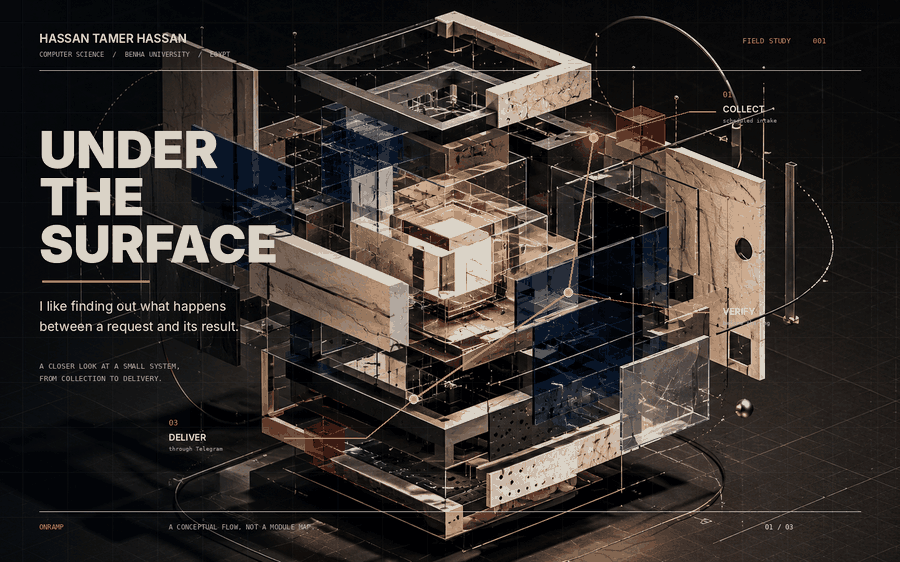
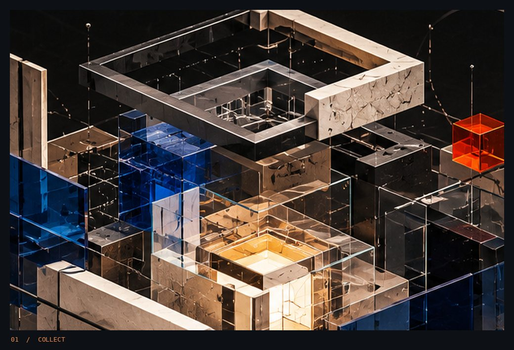
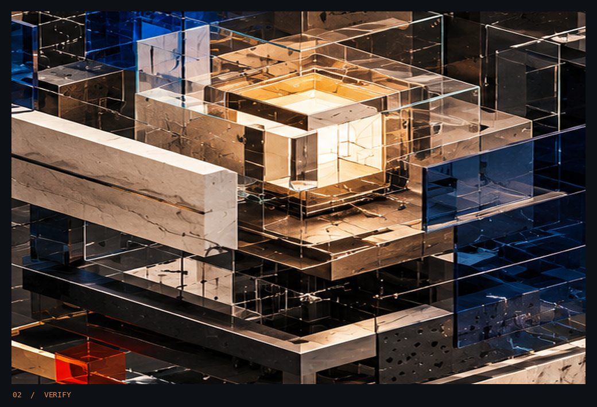
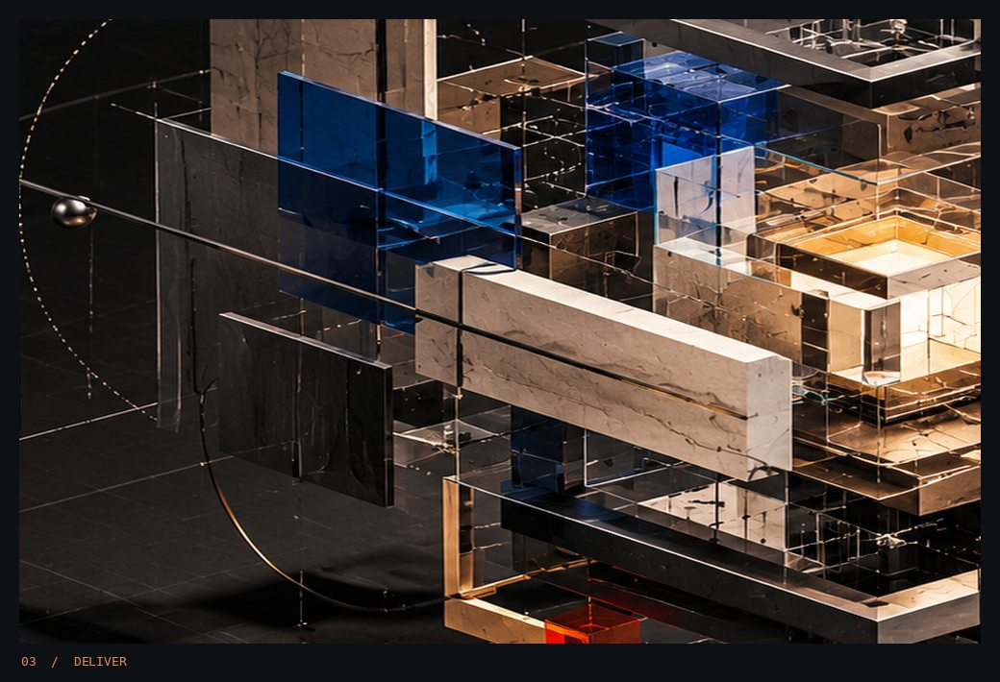

  <picture>
    <source media="(prefers-color-scheme: light)" srcset="./assets/system-study-still.jpg">
    
  </picture>

  <a href="#01-the-person">01 / THE PERSON</a>
  &nbsp; | &nbsp;
  <a href="#02-onramp">02 / ONRAMP</a>
  &nbsp; | &nbsp;
  <a href="#03-what-im-learning">03 / WHAT I'M LEARNING</a>
  &nbsp; | &nbsp;
  <a href="#04-find-me">04 / FIND ME</a>

## 01 / The person

Hi, I'm Hassan. I'm a Computer Science student at Benha University in Egypt.

I like understanding what happens after someone presses a button. The request, the data, the decisions in between, and the reason a system behaves the way it does. That's what pulled me towards backend engineering.

I'm still learning the fundamentals and building things to make them stick. I don't have a huge list of projects yet, so I'd rather show the one I'm working on properly.

## 02 / Onramp

[Open the repository](https://github.com/hssntmrq/Onramp)

Onramp is a Python Telegram bot that collects verified internship and training opportunities in Egypt and delivers them through Telegram. It runs as a scheduled pipeline, not as a real-time search bot.

The 3D model above is a conceptual view of that simple flow. It is not a map of the code or a claim about the project's internal architecture.

<b>01 / Collect</b>

Onramp gathers internship and training opportunities through a scheduled process.

<b>02 / Verify</b>

The goal is to share verified opportunities in Egypt. I'm interested in the decisions that make collected information useful and trustworthy.

<b>03 / Deliver</b>

The opportunities are delivered through Telegram. The bot works on a schedule rather than waiting for someone to search for a role.

<b>A few facts about the repository</b>

- Around 95 files
- Around 35 modules in `rung/`
- 32 test files
- Documentation and CI
- GitHub Actions workflows
- MIT licence

Onramp is my main software project right now. I'm not presenting it as a production-scale platform. I'm using it to learn how to take a useful idea, organise the code, test it, and keep improving it.

## 03 / What I'm learning

**Right now:** Python fundamentals and FastAPI. I have some exposure to backend development and have worked on a basic CRUD project. I'm still building the skills to create a complete CRUD application independently.

**Where I want to go:** backend architecture, distributed systems, AI infrastructure, data management, system design, performance and reliability.

Those are interests I'm working towards, not experience I'm claiming to have already.

<b>Questions I keep coming back to</b>

- What makes a system reliable when one part fails?
- How should data move through a backend application?
- Which trade-offs make an architecture simpler to operate?
- How do we measure performance instead of guessing?

I don't have all the answers. These are the questions I want to get better at answering.

## 04 / Find me

[GitHub](https://github.com/hssntmrq) / [LinkedIn](https://www.linkedin.com/in/hssntmrq/) / [Email](mailto:hssntmrq@gmail.com)

  Still learning. Still building. Still taking things apart to see how they work.

